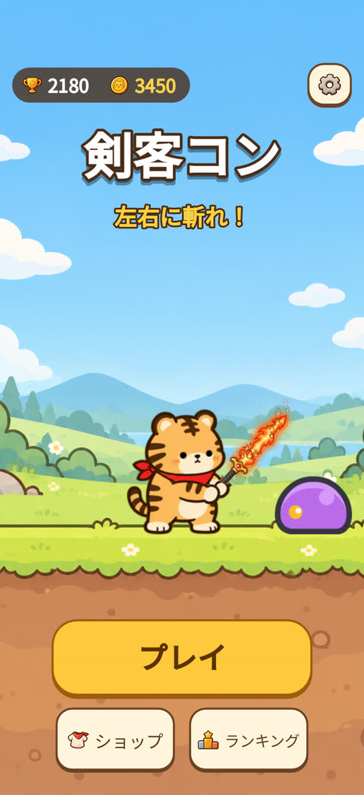
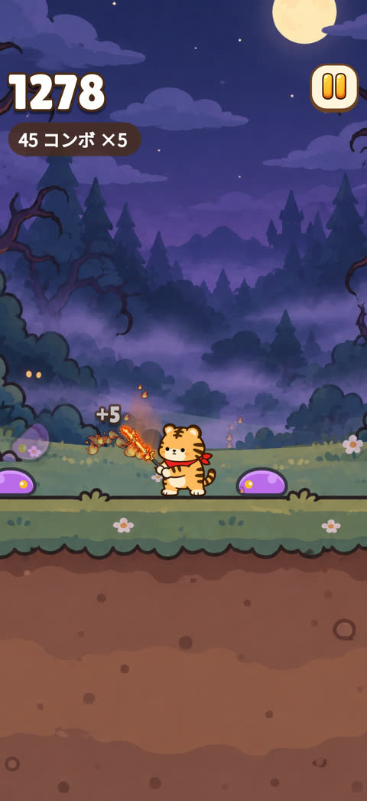
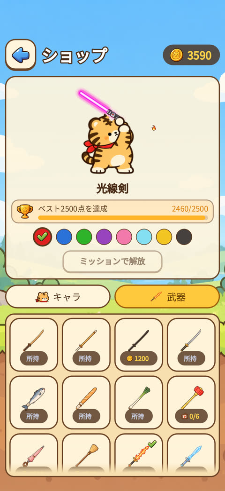
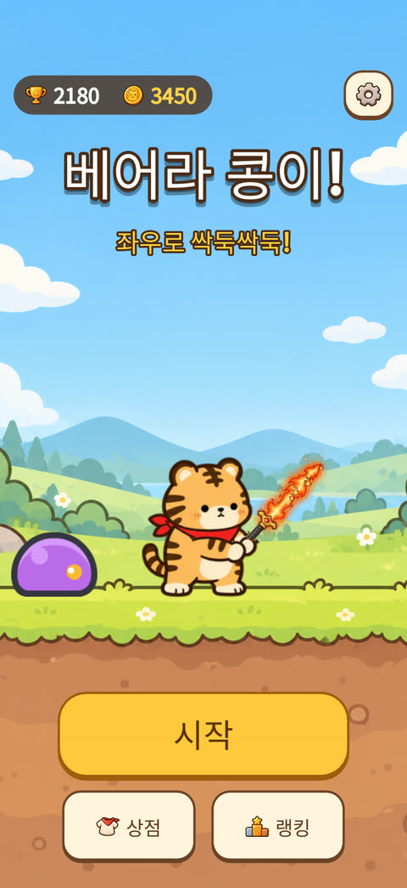
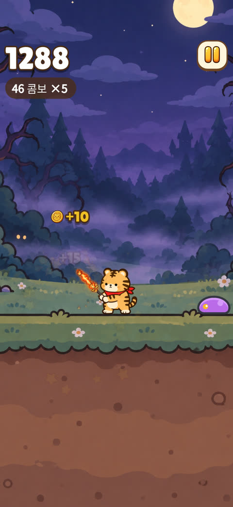
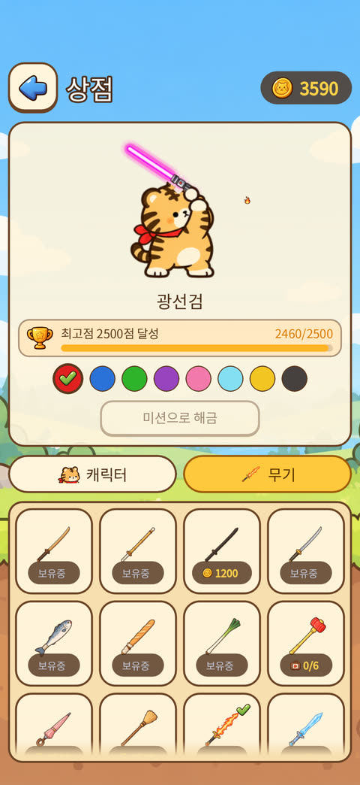
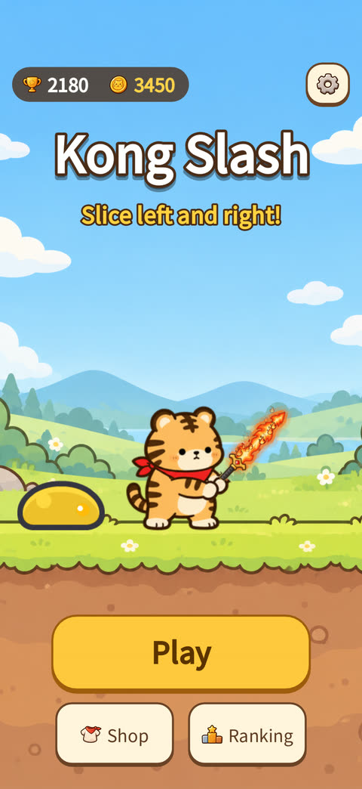
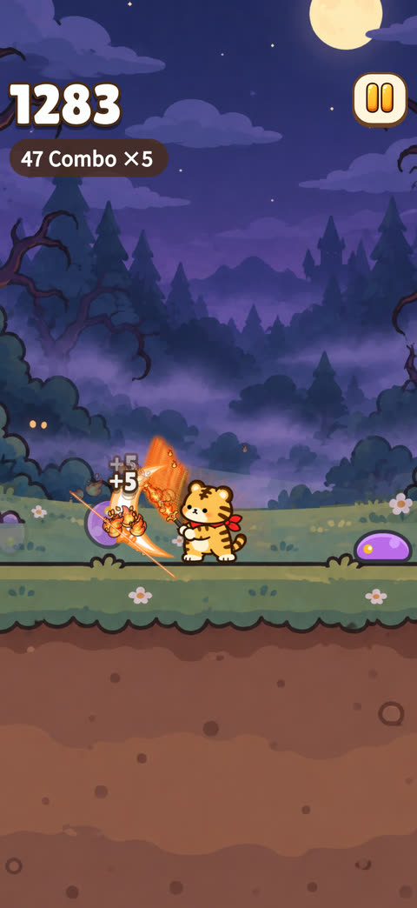
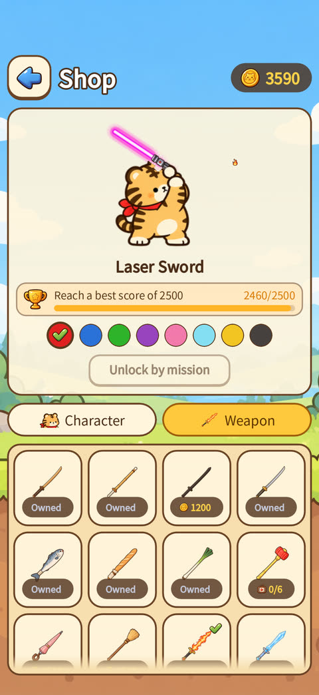

# 剣客コン · 베어라 콩이! · Kong Slash

**[▶ App Store で無料ダウンロード / 무료 다운로드 / Download free](https://apps.apple.com/app/id6823042608)** (iPhone)

## 日本語

画面の真ん中に立つわんこ剣客コン。左をタップすれば左を、右をタップすれば右を斬ります。操作はそれだけ。

- 左右タップだけのかんたん操作、でも後半はどんどん速く
- 木刀・ネギ・バゲット・魚・光の剣… 武器ごとに音とエフェクトが違う
- 柴犬・黒猫・パンダ・トラなど 8 匹のキャラクター
- 週間ランキング・登録不要

## 한국어

화면 가운데 선 콩이. 왼쪽을 탭하면 왼쪽을, 오른쪽을 탭하면 오른쪽을 벱니다. 조작은 그게 전부예요.

- 좌우 탭만으로 하는 쉬운 조작, 하지만 갈수록 빨라져요
- 목검·대파·바게트·생선·광선검… 무기마다 소리와 이펙트가 달라요
- 시바견·검은 고양이·판다·호랑이 등 캐릭터 8종
- 주간 랭킹 · 가입 필요 없음

## English

Kong the puppy swordsman stands in the middle of the screen. Tap the left half to slash left, the right half to slash right. That's it.

- Two-button controls that get faster and faster
- Wooden sword, leek, baguette, fish, light saber… every weapon sounds and sparkles differently
- 8 characters including Shiba, black cat, panda and tiger
- Weekly leaderboard, no sign-up

---

X: [@KONG_E_OFFICIAL](https://x.com/KONG_E_OFFICIAL) ·
[プライバシーポリシー / 개인정보처리방침 / Privacy](privacy/) ·
[サポート / 지원 / Support](support/)
